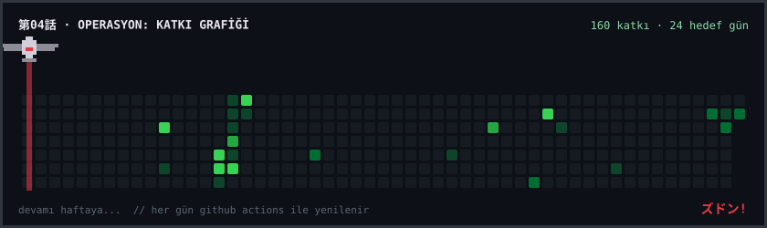
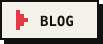

<!--
  omertugrulbayram // profil README
  Kareler scripts/generate.py ile üretilir, GitHub Actions her gün yeniler.
  Metinleri değiştirmek için generate.py içindeki CONFIG'i düzenle.
-->

&nbsp;
&nbsp;

<code>// bölüm sonu — devamı haftaya ▮</code>

