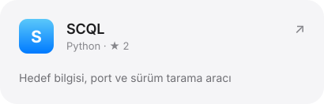
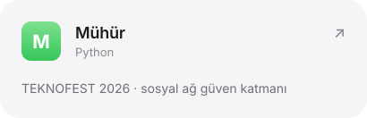
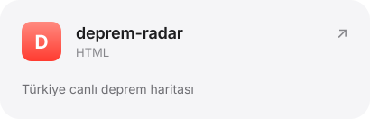
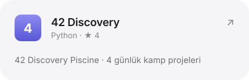
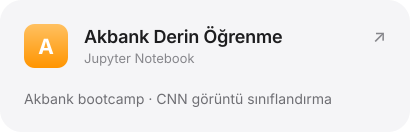
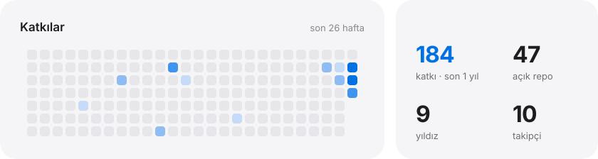
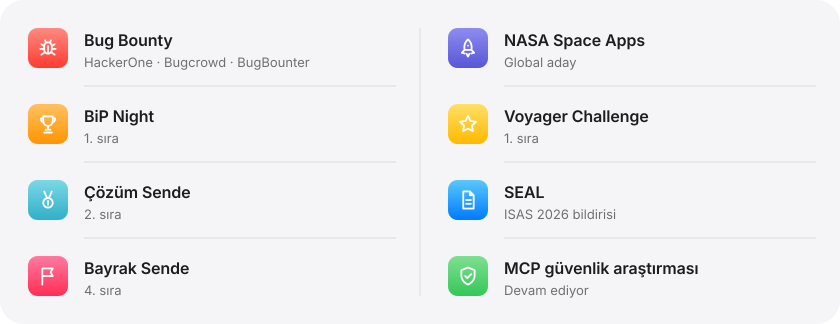

<!--
  omertugrulbayram // profil README
  Bu dosya scripts/generate.py ile üretilir — elle düzenleme, CONFIG'i değiştir.
-->

<picture><source media="(prefers-color-scheme: dark)" srcset="assets/hero-dark.svg"></picture>

<a href="https://omertugrulbayram.com"><picture><source media="(prefers-color-scheme: dark)" srcset="assets/btn-0-dark.svg"></picture></a>&nbsp;<a href="https://www.linkedin.com/in/omertugrulbayram"><picture><source media="(prefers-color-scheme: dark)" srcset="assets/btn-1-dark.svg"></picture></a>&nbsp;<a href="https://twitter.com/0m3rb4yr4m"><picture><source media="(prefers-color-scheme: dark)" srcset="assets/btn-2-dark.svg"></picture></a>&nbsp;<a href="https://kaggle.com/merturulbayram"><picture><source media="(prefers-color-scheme: dark)" srcset="assets/btn-3-dark.svg"></picture></a>

 

<picture><source media="(prefers-color-scheme: dark)" srcset="assets/h-projeler-dark.svg"></picture>

<a href="https://github.com/omertugrulbayram/bipnight"><picture><source media="(prefers-color-scheme: dark)" srcset="assets/p0-dark.svg"></picture></a>&nbsp;<a href="https://github.com/omertugrulbayram/muhur"><picture><source media="(prefers-color-scheme: dark)" srcset="assets/p1-dark.svg"></picture></a>

<a href="https://github.com/omertugrulbayram/deprem-radar"><picture><source media="(prefers-color-scheme: dark)" srcset="assets/p2-dark.svg"></picture></a>&nbsp;<a href="https://github.com/omertugrulbayram/42_discovery_piscine"><picture><source media="(prefers-color-scheme: dark)" srcset="assets/p3-dark.svg"></picture></a>

<a href="https://github.com/omertugrulbayram/Akbank-Derin-Ogrenme-Projesi"><picture><source media="(prefers-color-scheme: dark)" srcset="assets/p4-dark.svg"></picture></a>

 

<picture><source media="(prefers-color-scheme: dark)" srcset="assets/h-aktivite-dark.svg"></picture>

<picture><source media="(prefers-color-scheme: dark)" srcset="assets/activity-dark.svg"></picture>

 

<picture><source media="(prefers-color-scheme: dark)" srcset="assets/h-basarimlar-dark.svg"></picture>

<picture><source media="(prefers-color-scheme: dark)" srcset="assets/awards-dark.svg"></picture>

