<div align="center">

<!-- Animasyonlu Amber Typing Prompt -->
<a href="https://github.com/omertugrulbayram">
  
</a>

<!-- CRT Neofetch Kartı -->


</div>

<br/>

```text
┌─[omertugrul@crt]─[~/active-modules]
└──╼ $ ls -la

drwxr-xr-x  01  offensive-security/   Web & API Pentesting, Bug Bounty, Exploit Research
drwxr-xr-x  02  automation-tools/     Python CLI Solvers, Recon Pipelines, Security Bots
drwxr-xr-x  03  ctf-writeups/         TryHackMe, Hack The Box, Malware & Reverse Engineering
drwxr-xr-x  04  side-experiments/     3D Web Games, Mini UAV Prototyping, Local LLMs
