

  

  
  
  
  
  
  
  

  

  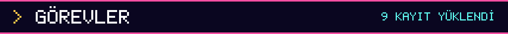

  <a href="https://github.com/omertugrulbayram/SCQL"></a>
  <a href="https://github.com/omertugrulbayram/ctf-writeups"></a>
  <a href="https://github.com/omertugrulbayram/BugBountyTool"></a>
  <a href="https://github.com/omertugrulbayram/muhur"></a>
  <a href="https://github.com/omertugrulbayram/nasa-space-app-project-astrovia"></a>
  <a href="https://github.com/omertugrulbayram/deprem-radar">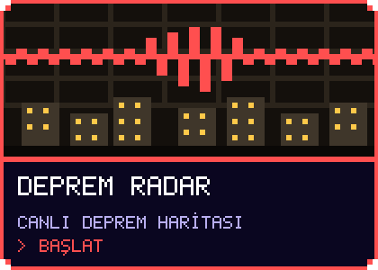</a>
  <a href="https://github.com/omertugrulbayram/namaz-vakit">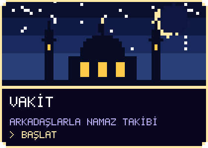</a>
  <a href="https://github.com/omertugrulbayram/42_discovery_piscine">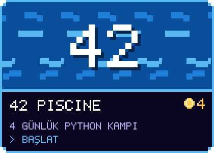</a>
  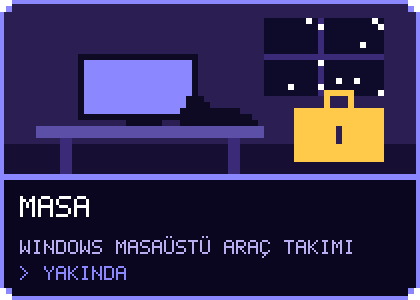

  

  

