  

  <a href="https://omertugrulbayram.com">blog</a> · <a href="https://twitter.com/0m3rb4yr4m">x</a> · <a href="https://linkedin.com/in/omertugrulbayram">linkedin</a> · <a href="https://kaggle.com/merturulbayram">kaggle</a> · <a href="https://instagram.com/omerbayramm41">instagram</a> · <a href="https://www.topcoder.com/members/41200">topcoder</a> · <a href="mailto:omertugrulbayram@gmail.com">e-posta</a>

### `> projeler`

- [`SCQL`](https://github.com/omertugrulbayram/SCQL) hedef bilgisi, port ve sürüm tarama aracı
- [`ctf-writeups`](https://github.com/omertugrulbayram/ctf-writeups) TryHackMe ve Hack The Box çözüm notları
- [`BugBountyTool`](https://github.com/omertugrulbayram/BugBountyTool) temel bug bounty tarama aracı
- [`mühür`](https://github.com/omertugrulbayram/muhur) TEKNOFEST 2026, sosyal ağ güven katmanı
- [`astrovia`](https://github.com/omertugrulbayram/nasa-space-app-project-astrovia) NASA Space Apps 2025, asteroit tespiti
- [`deprem-radar`](https://github.com/omertugrulbayram/deprem-radar) Türkiye canlı deprem haritası
